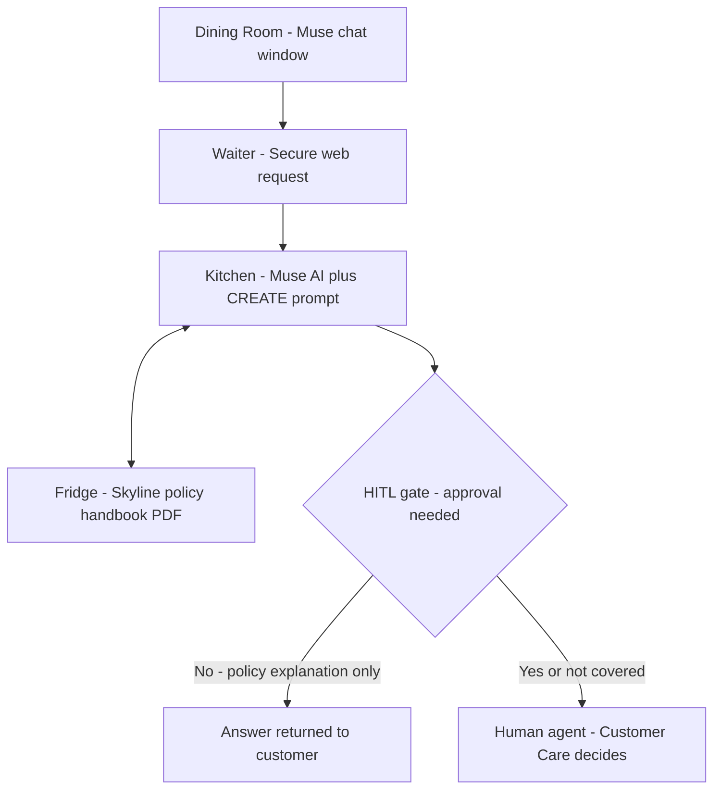

# System Architecture: The Restaurant Analogy

[Back to the main page](README.md)

## Why a Restaurant?

Executives who are not engineers can understand an AI system if it is explained as a restaurant. The customer sits in the **Dining Room**, a **Waiter** carries orders and food back and forth, the **Kitchen** cooks, and the **Fridge** holds the ingredients. Below, each part is mapped to the real Skyline Air prototype and to what it would become in an enterprise deployment.

## Architecture Diagram

## Mapping Table

| Restaurant part | Role | In this prototype | In an enterprise deployment |
|---|---|---|---|
| **Dining Room** (Front-End) | What the customer sees and touches | Muse chat window | Airline website or app chat widget |
| **Waiter** (API Layer) | Carries requests and responses between systems | Secure web connection (HTTPS) to Muse's cloud | API gateway, webhooks that alert human agents, and Model Context Protocol (MCP) connectors to approved tools |
| **Kitchen** (Back-End and LLM Brain) | Where the reasoning and prompt execution happen | Muse AI model following the CREATE system prompt | A tiered set of models behind a router (see [06-tokenomics-and-roi.md](06-tokenomics-and-roi.md)) |
| **Fridge** (Database / Vector Store) | Where the trusted data is stored | The 3-page synthetic handbook PDF | A vector database holding thousands of chunked policy pages |
| **HITL Gate** (the manager at the pass) | Final human check before anything is approved | The assistant refuses to approve and refers to Customer Care | A case-ticket queue where trained agents approve refunds and exceptions |

## The Four Parts Explained

**The Dining Room (Front-End).** This is everything the customer sees and touches: the Muse chat window, where a traveler types a question like "What do I pay for a 52-pound bag?" and reads the reply. The customer never sees the rules, the document, or the AI model, only a simple chat box. That is why this layer should be easy to use and clearly branded.

**The Waiter (API Layer).** The waiter carries the customer's question from the Dining Room to the Kitchen and brings the answer back. Technically this is a secure web connection (HTTPS) between the chat window and the cloud servers running the AI. In a larger production version, this layer could also use webhooks (automatic notifications between systems) to alert a human agent when a request needs approval, and the Model Context Protocol (MCP), a standard way for AI systems to connect to approved tools. This layer is also where security controls sit.

**The Kitchen (Back-End and LLM Brain).** This is where the thinking happens. The AI model receives the customer's question together with the CREATE system prompt, which acts as the chef's recipe card: who the assistant is, what it may do, what it must never do, and what format every answer must follow. The model finds the relevant handbook sections, writes a short answer, and cites the section number. Because the prompt forbids guessing, the Kitchen may cook only with ingredients from the Fridge.

**The Fridge (Database / Knowledge Store).** This is where the trusted ingredients live. In this prototype it is the 3-page synthetic Skyline Air Policy Handbook, with no real customer or company data. The Kitchen looks things up here instead of relying on memory, which is the core idea of RAG (Retrieval-Augmented Generation): retrieve the facts first, then generate the answer. In a full enterprise version, the handbook would be split into small chunks and stored in a vector database (a search system that finds passages by meaning), so thousands of policy pages could be searched quickly.

## The Human-in-the-Loop Gate

Between the Kitchen and the customer sits one final check. If the answer only explains policy, it goes straight back to the customer through the Waiter. If the request involves approving a refund, issuing a voucher, granting an exception, or anything the handbook does not cover, the assistant cannot decide and hands the case to a human agent at Skyline Air Customer Care. [05-governance.md](05-governance.md) explains why this gate protects the company legally.
