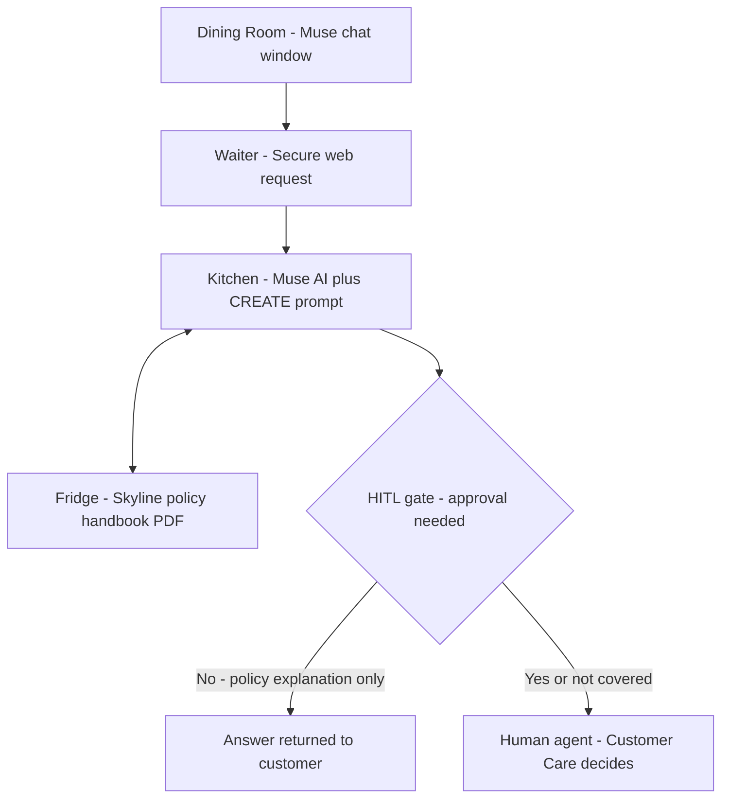

# System Architecture: The Restaurant Analogy

[Back to the main page](README.md)

To explain how my assistant works to non-technical people, I mapped it to a restaurant: the customer sits in the dining room, a waiter carries orders, the kitchen cooks, and the fridge stores the ingredients.

## The Parts

**Dining Room (front-end).** This is the chat window in Meta Muse where the customer types a question and reads the answer. They never see the rules or the AI behind it.

**Waiter (API layer).** The waiter carries the question to the AI and brings the answer back. In my prototype this is just Muse's secure web connection. In a real company it would also use
